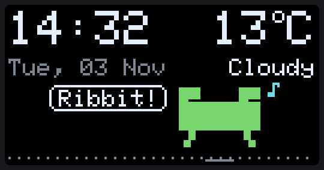
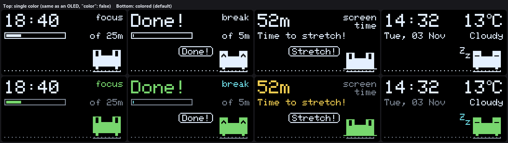

# KeroBuddy

A tiny pixel frog that lives in the corner of your screen, always on top. Kero shows the **time and weather**, **air quality**, how your **PC** is doing and your **screen time**. It runs a **focus timer** and reminds you to **stretch**. No accounts and no AI needed, and nothing leaves your computer.

<p align="center">
  
</p>

<p align="center">
  
</p>

Prefer the look of a real OLED? Set `"color": false` ([single-color preview](docs/kerobuddy-mono.gif)).

## What it shows

An **info card** on top (slides to the next card every few seconds) and Kero's little world below.

| Card | Example |
|---|---|
| Time + weather | `14:32      13°C` / `Tue, 03 Nov   Cloudy` |
| Air quality | `Air: Fine` / `OK to air out` + pollution meter |
| PC | `PC: Chill` / `CPU 23% RAM 61%   84%+` |
| Screen time | `52m` / `break in 8m` → `Time to stretch!` |
| Focus timer | `18:42 focus` / progress bar |

## What Kero does

| When… | Kero… |
|---|---|
| nothing special | sits, blinks, glances around, hops about, croaks now and then |
| it's a new hour | croaks twice |
| a fly shows up (every few minutes) | watches it, then zaps it with its tongue |
| your focus session ends | screen flashes, catches a fly, `Done!`, then counts down your break |
| you've been at the screen for 50 min | jumps with `Stretch!` until you take a break (or click to snooze 10 min) |
| it's raining / snowing | rain or snow falls, Kero does little rain-dance hops |
| your CPU is maxed out | sweats |
| battery is below 20% | gets tired eyes, moves less |
| your microphone is in use (a call) | stays quiet: no croaks, no flies, no reminders |
| you're away (no mouse/keyboard for 5 min) or it's night | falls asleep, `zZ`. Says `Hi again!` when you're back |

**Controls:** click = hop (and dismiss an alert) · double click = next card · hold = pet it ♥ · **right click = start / stop the focus timer**

## Run it

You need Python 3 and Edge or Chrome (Windows). No extra packages.

```bash
python kero.py
```

A small window appears in the bottom-right corner, just above the taskbar, and stays on top of other windows. Close it to stop Kero. You can drag it by its title bar.

**Start automatically at login (Windows):**

```bash
python kero.py --install-startup      # undo with --uninstall-startup
```

**Check the sensors:** `python kero.py --sensors` prints what Kero reads (idle time, CPU, RAM, battery, mic in use).

**Preview a state** without waiting for it: open `http://127.0.0.1:8797/#demo=stretch` (also `focus`, `done`, `sleep`, `rain`, `snow`, `hot`, `pet`, `fly`, `croak`, `card=0` … `card=4`).

**macOS:** `python kero.py` opens Kero in a small Chrome/Edge app window with all the cards and sensors (CPU from load average; no RAM or mic yet). Keeping it on top of other windows isn't built in yet.

## Settings

Copy `config.example.json` to `config.json` and change what you like. Every field is optional:

| Field | Default | Meaning |
|---|---|---|
| `latitude`, `longitude` | Almaty | where the weather and air quality come from |
| `focus_minutes` / `break_minutes` | 25 / 5 | focus timer and the break after it |
| `break_every` | 50 | minutes of screen time before `Stretch!` |
| `away_minutes` | 5 | no input this long = you're away, Kero naps. A pause of `break_minutes` counts as a break |
| `hour_chime` | true | croak on the hour |
| `night_start`, `night_end` | 23, 7 | night hours: Kero dozes off sooner and skips the hour chime |
| `color` | true | false = single color, like a real OLED |
| `corner` | bottom-right | `bottom-right`, `bottom-left`, `top-right`, `top-left` |
| `scale`, `margin`, `margin_top` | 3, 12, = margin | window size (128×64 × scale) and the gap to the screen edge |

## Privacy

Kero only checks *how long* since you last touched the mouse or keyboard. It never sees what you type. "Microphone in use" comes from Windows' own privacy records; Kero never listens. Everything stays on `127.0.0.1`. The only internet requests are weather and air quality from [Open-Meteo](https://open-meteo.com/) (no key, no account).

## How it works

`kero.py` serves the page, reads the PC sensors every 2 s and keeps the window on top. `web/kero.js` draws everything into a 128×64 one-bit frame buffer, the same as a little SSD1306 OLED, so Kero can move to an ESP32 desk gadget later, like its cousin [ClawdBuddy](https://github.com/eriknurgulde/ClawdBuddy). The pixel renderer and font are taken from there (Adafruit GFX port, BSD-licensed font).
